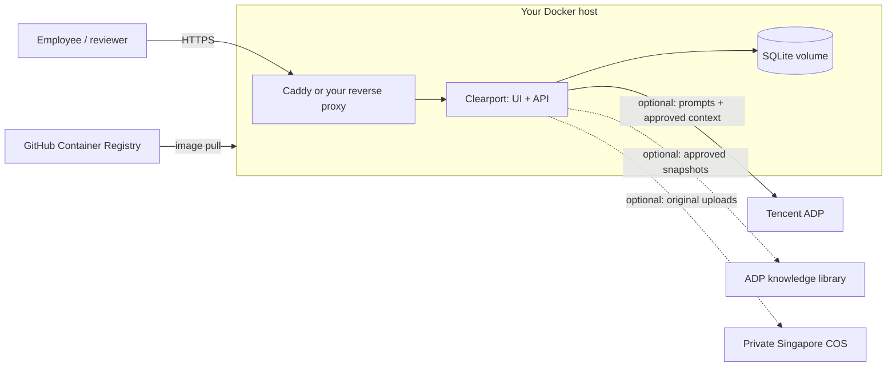

# Deploy Clearport

You operate the Docker host, domain, HTTPS and backups. Tencent supplies the optional ADP agent, knowledge synchronization and Singapore COS archive. **No Tencent CVM or provisioning credentials are required.**

The GitHub workflow publishes a tested Linux amd64 image to GHCR. You choose when to pull and run it. This remains a single-instance, single-operator prototype with SQLite; see the [access limits](README.md#access-governance-and-deployment-limits).

## Deployment layout



Clearport keeps the authoritative cases, knowledge, comments and approval decisions in SQLite. ADP provides advice; people approve documents in Clearport. Tencent connections originate from the backend over HTTPS; ADP does not need an inbound callback to your host.

## 1. Prepare your host

Use a **Linux amd64** Docker host with Docker Engine and the Compose plugin. The published image targets amd64. Choose a host location appropriate for your data; the application's Singapore use case does not dictate its hosting provider.

Copy these files into one directory on your host, or check out the repository:

- `compose.yaml`
- `compose.https.yaml` if using the supplied Caddy proxy
- `.env.deploy.example`
- `deploy/Caddyfile` and `deploy/preflight.sh`

Create the runtime configuration without overwriting an existing file:

```sh
umask 077
cp -n .env.deploy.example .env.deploy
chmod 600 .env.deploy
nano .env.deploy
```

Set `APP_ACCESS_PASSWORD` to a unique value of at least 12 characters. The login username is **clearport**. `APP_USER_ID` defaults to the seeded manager `manager-sarah`; it does not create a new identity. Quote values containing `$` with single quotes in the environment file to prevent Compose interpolation.

| Setting               | Purpose                                                                         |
| --------------------- | ------------------------------------------------------------------------------- |
| `CLEARPORT_IMAGE`     | Published GHCR image; prefer a `sha-<full-40-character-commit-SHA>` tag.        |
| `CLEARPORT_PORT`      | Host loopback port; default `3001`.                                             |
| `APP_ACCESS_PASSWORD` | Required application password.                                                  |
| `APP_COOKIE_SECURE`   | `true` for HTTPS; `false` only for localhost or an SSH tunnel over HTTP.        |
| `CLEARPORT_DOMAIN`    | Hostname without a scheme, path or port; required for the supplied HTTPS proxy. |
| `CLEARPORT_TLS_EMAIL` | Certificate contact email for that proxy.                                       |
| `AI_PROVIDER`         | `local` by default; choose `adp` after configuring the Tencent application.     |

Keep real values in the host's ignored `.env.deploy` or its secret manager. The old `.env.tencent` contains infrastructure-discovery credentials and is **not used by this deployment**. Do not copy it to the host, image or application configuration.

## 2. Choose the Tencent features

Start with the app's local advisor, or follow [Tencent application setup](deploy/tencent-access.md) to enable ADP:

```dotenv
AI_PROVIDER=adp
ADP_APP_KEY='your-published-application-key'
ADP_ENDPOINT=https://wss.lke.tencentcloud.com/adp/v2/chat
ADP_KNOWLEDGE_SYNC=false
ADP_AUTO_PUBLISH=false
COS_BUCKET=
```

For chat and pre-review, `ADP_APP_KEY` is the only Tencent credential required. Leave `TENCENT_SECRET_ID`, `TENCENT_SECRET_KEY` and `TENCENT_TOKEN` blank in this mode. Use the [agent instructions](deploy/adp-agent.md) in a dedicated published ADP application.

Chat-only mode sends relevant approved local context with each request. It does not synchronize the full knowledge library into ADP.

### Optional ADP knowledge synchronization

Enable only after confirming the account supports the legacy management API and its usage is covered. It needs the application's business ID and a scoped runtime CAM identity in addition to the chat key. See [Tencent access](deploy/tencent-access.md) for settings, permissions and publication steps. Keep `ADP_AUTO_PUBLISH=false` initially: automatic publication releases every pending draft in that ADP application.

### Optional original-file archive in Singapore COS

A private `ap-singapore` COS bucket can retain original uploads. It needs narrowly scoped upload permission and is independent of ADP's managed upload storage. See [Tencent access](deploy/tencent-access.md). This archive is **not a backup of SQLite**.

Your Tencent spending limit remains **$0**. Self-hosting removes the CVM requirement; it does not make ADP or COS free. Keep `AI_PROVIDER=local`, `ADP_KNOWLEDGE_SYNC=false` and `COS_BUCKET` empty until the applicable service allowance and overage behavior are confirmed. No live Tencent usage is required to deploy the local mode.

## 3. Pull or build the image

For this repository, the registry is `ghcr.io/robothanzo/tencenthackathon2026`. Forks use their own lowercase owner/repository path.

The [GitHub workflow](.github/workflows/docker.yml) builds and tests the application and container, then publishes the **same tested image**:

| Trigger                | Result                                                        |
| ---------------------- | ------------------------------------------------------------- |
| Pull request to `main` | Validate only.                                                |
| Push to `main`         | Publish `main` and `sha-<full-commit-SHA>`.                   |
| Push a `v*` tag        | Publish that tag and the full SHA tag.                        |
| Manual dispatch        | Validate the selected ref; publish only `main` or a `v*` tag. |

The workflow uses GitHub's `GITHUB_TOKEN` with `packages: write`. It does not need Tencent credentials or SSH access and does not restart your host. Local uncommitted changes are not included in an existing registry image.

For a private package, log in with an account that can read it and a personal access token (classic) with `read:packages`. Supply the token through standard input; keep it separate from `.env.deploy`. See [GitHub's container registry guide](https://docs.github.com/en/packages/working-with-a-github-packages-registry/working-with-the-container-registry).

```sh
read -r -p 'GitHub username: ' GHCR_USER
read -r -s -p 'GHCR read:packages token: ' GHCR_TOKEN
printf '\n'
printf '%s' "$GHCR_TOKEN" | docker login ghcr.io -u "$GHCR_USER" --password-stdin
unset GHCR_TOKEN
```

Alternatively, build your current checkout on a Linux amd64 Docker host:

```sh
docker build -t clearport:local .
```

Set `CLEARPORT_IMAGE=clearport:local`, skip the image pull, and use `up -d --wait --pull never` for base Compose. With the Caddy overlay, first pull its image separately using `docker compose --env-file .env.deploy -f compose.yaml -f compose.https.yaml pull caddy`.

## 4. Start the containers

Choose one of these access paths. Keep the same Compose files for later updates and restarts.

### Supplied HTTPS proxy

Point the hostname's DNS to your host. Allow inbound TCP 80/443 for Caddy and certificate validation; keep port 3001 private. Provide `CLEARPORT_DOMAIN` and `CLEARPORT_TLS_EMAIL`. Caddy needs outbound certificate-service access and persistent volumes. See [Caddy HTTPS requirements](https://caddyserver.com/docs/automatic-https).

```sh
bash deploy/preflight.sh https
docker compose --env-file .env.deploy -f compose.yaml -f compose.https.yaml pull
docker compose --env-file .env.deploy -f compose.yaml -f compose.https.yaml run --rm --no-deps caddy caddy validate --config /etc/caddy/Caddyfile --adapter caddyfile
docker compose --env-file .env.deploy -f compose.yaml -f compose.https.yaml up -d --wait
docker compose --env-file .env.deploy -f compose.yaml -f compose.https.yaml ps
```

Open `https://YOUR_DOMAIN`. The overlay forces secure cookies, preserves the original Host header and allows request bodies up to 11 MB for the app's 10 MB upload limit.

`compose.tencent.yaml` is retained as the legacy name for the same HTTPS configuration. Existing installations can keep using it, or replace that filename with `compose.https.yaml` while keeping the project name and volumes. Use **one HTTPS overlay**, not both.

### Your existing HTTPS proxy

Use base `compose.yaml` and set `APP_COOKIE_SECURE=true`. A proxy on the same host can forward to `http://127.0.0.1:3001`; preserve the original Host header and permit an 11 MB request body. A proxy in another container must share a private Docker network with Clearport and forward to `clearport:3001`; its own loopback address does not reach Clearport. Configure that shared network in your own Compose overlay.

```sh
docker compose --env-file .env.deploy config --quiet
docker compose --env-file .env.deploy pull
docker compose --env-file .env.deploy up -d --wait
```

### Localhost or SSH tunnel

Use base Compose, keep `APP_COOKIE_SECURE=false`, and leave the domain settings empty:

```sh
bash deploy/preflight.sh tunnel
docker compose --env-file .env.deploy pull
docker compose --env-file .env.deploy up -d --wait
```

For a remote host, open an SSH tunnel from your computer using your existing SSH access:

```sh
ssh -N -L 127.0.0.1:3002:127.0.0.1:3001 user@your-host
```

Visit `http://127.0.0.1:3002` while the tunnel is open. For Docker on your own computer, visit `http://127.0.0.1:3001`. Change `CLEARPORT_PORT` and the tunnel destination together if the host port is occupied.

## 5. Verify

1. Request `/api/health` on the deployed site. It should report `ok: true`; this checks the app, not provider entitlement.
2. Confirm unauthenticated `/api/state` returns 401, then sign in as `clearport` with your application password.
3. With HTTPS, confirm the session cookie has `Secure`, `HttpOnly` and `SameSite=Strict`.
4. Import fictional knowledge, approve it, review a fictional case, and inspect advice and citations.
5. If ADP is enabled and its usage is covered, run **Settings → Check connection**. This makes a real model request. Confirm a connected response and valid sources; a configured status or local fallback is not proof of ADP success.

The first run seeds fictional Singapore records. Data persists in the `clearport_data` volume at `/app/data/clearport.db`. Keep one app instance and the same Compose project name (`clearport`) when updating.

Use `config --quiet` for validation: plain `config` prints interpolated secrets. Review container logs privately before sharing them.

## Backup, update and rollback

The following commands use base Compose. If using Caddy, add `-f compose.yaml -f compose.https.yaml` to **every** command so the HTTPS settings remain applied.

Stop the app while copying the entire data directory. Replace the backup name with a new timestamp:

```sh
docker compose --env-file .env.deploy stop clearport
docker compose --env-file .env.deploy cp clearport:/app/data/. ./clearport-backup-YYYYMMDD-HHMMSS
docker compose --env-file .env.deploy start --wait clearport
```

Preserve any SQLite WAL/SHM files with their matching database and keep the completed backup outside the host. With Caddy, also retain its `caddy_data` and `caddy_config` volumes. Original-file COS archival does not cover these volumes. See [SQLite backup guidance](https://www.sqlite.org/howtocorrupt.html#backup_or_restore_while_a_transaction_is_active).

Record the current image reference, update `CLEARPORT_IMAGE` to a tested tag, then:

```sh
docker compose --env-file .env.deploy pull
docker compose --env-file .env.deploy up -d --wait
docker compose --env-file .env.deploy ps
```

Verify login, retained records and the chosen provider. To roll back code, restore the previous compatible image reference and repeat. An image rollback does not roll back data; restore a matching full database snapshot only with the app stopped and the target data directory empty, owned by UID/GID `1000:1000`.

`docker compose down` keeps named volumes. **Do not use `down -v` unless you intend to delete the stored workspace.**
