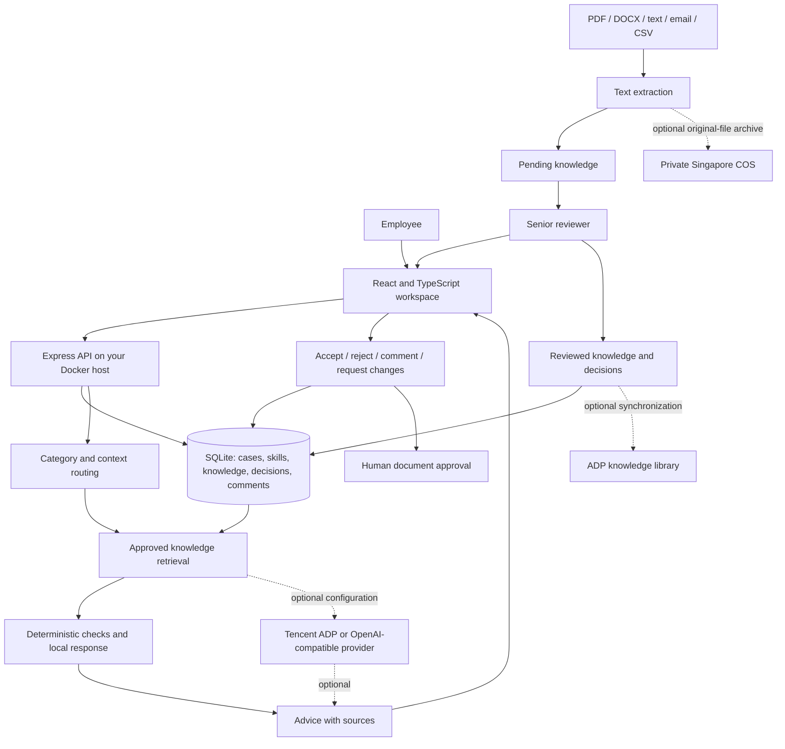

# Instill — submission working draft

**Project title:** Instill\
**Short blurb:** Expert customs knowledge, captured in every approval.  
**Blurb length:** 7 words  
**Product scope:** Singapore customs brokerage, English-language interface  
**Challenge:** Keppel Real Estate — AI HARVEST: Turning Expert Know-How into Reusable Intelligence

This document prepares the project narrative and identifies evidence still needed. It does not certify eligibility or represent a submitted application.

## Problem and users

Customs brokerage staff prepare declarations, supporting documents, and customer communications under time pressure. Written instructions alone do not ensure that an employee notices a relevant exception. Senior staff repeatedly correct similar mistakes, but the reasoning behind those corrections often stays in a conversation or a marked-up document.

Instill places a specialist advisor before management approval and turns the manager's normal review into reusable knowledge. Employees get contextual checks and an agent consultation workspace. Managers keep the final decision, can reject unsuitable AI advice, and leave the reasoning that helps the next employee.

The discovery evidence is the [interview summary](USER_STORY_SUMMARY.md), [original transcript](USER_STORY_TRANSCRIPT.md), and [customs service description](CUSTOMS_SERVICE.md). The strongest findings are that proactive reminders are needed at the moment of work, human review must remain, and knowledge capture should not create a separate administrative task. These interviews establish a workflow problem; they do not establish Singapore regulations or measured product effectiveness.

## Solution and current implementation

| Need | Instill workflow |
| --- | --- |
| Capture existing expertise | Import text-bearing PDF, DOCX, TXT, MD, EML, or CSV documents and associate the extracted knowledge with a specialist skill. |
| Capture undocumented judgment | Record accept/reject decisions and explanations while managers review case-specific recommendations. |
| Make expertise reusable | Store knowledge with its domain, source, author, approval status, and relationship to a case or skill. |
| Apply specialist support | Route pre-approval reviews and consultation questions to relevant Singapore skills and cite approved knowledge. |
| Keep people in control | Managers review individual findings, request changes, and make the internal document approval decision. |
| Improve later work | Retrieve approved imported knowledge and reviewed decision records for subsequent cases and consultations. |
| Preserve the operational context | Keep case content, recommendations, reviewer decisions, comments, and activity in an API-backed SQLite database. |

The default advisor is deterministic retrieval and rule evaluation. Server-side adapters support Tencent Cloud International ADP's native SSE API and OpenAI-compatible providers, with a default 20-second timeout and explicit local fallback. Optional Tencent integrations synchronize approved knowledge through a persistent queue and archive original files in private Singapore COS storage. The application includes a manager-only connection check, publication status and retry controls. The team operates Docker hosting; Tencent supplies the configured application services, with no CVM requirement. See [DEPLOY.md](../DEPLOY.md), [Tencent access](../deploy/tencent-access.md), and [ADP agent setup](../deploy/adp-agent.md). Local protocol tests do not establish live ADP/COS access; service entitlement and deployment still need verification.

## Architecture

The browser communicates with the API on the team's Docker host through HTTPS. Durable workflow data stays in its SQLite volume; text extraction and local retrieval run in Instill. Optional Tencent connections are outbound HTTPS calls from the backend. ADP receives supplied context and, when enabled, approved knowledge snapshots; COS retains original files only when archival is configured. Approval remains an internal human decision.

## What makes this more than a chatbot

A consultation-only system waits for an employee to recognize a problem. Instill also checks the document before approval and presents a concrete finding in the context of that case. It then records whether the expert accepted the suggestion, rejected it, or requested a correction. The decision becomes part of the knowledge used in later work. Case workflow, evidence, and human review are therefore part of the product, rather than surrounding manual tasks.

The local baseline does not use model prompts. It selects skills from category and keyword context, ranks approved knowledge, and applies deterministic checks. Automotive descriptions with wireless components can select both automotive and electronics expertise, alongside general cargo guidance. This is bounded specialist routing, not a claim of autonomous multi-agent negotiation.

The optional model adapter's prompt construction is in [server/advisor.ts](../server/advisor.ts). A system instruction establishes the Singapore pre-approval role, treats supplied document and knowledge text as untrusted data, limits advice to supplied approved references, distinguishes official sources from internal SOPs, and preserves human authority. Case data, retrieved knowledge, and deterministic findings are passed as structured user content. Review generation requests JSON with a short summary and up to three additional observations; the server checks required fields and attaches only recognized source IDs. Consultation requests concise next steps, citations, and identification of missing evidence. These checks improve traceability but do not prove factual correctness or eliminate prompt injection.

When demonstrating a live provider, add the actual provider/model details and a redacted request/response example. Do not describe the local baseline as an LLM or imply a particular external model has been tested without evidence.

## Keppel challenge alignment

The handbook's named scenario is commercial real estate. Instill uses customs brokerage as the implemented evidence-backed domain; the shared capability is turning expert corrections into governed, reusable support. The real estate mapping is a proposed extension, not an implemented property-management integration.

| Implemented brokerage pattern | Proposed Keppel application |
| --- | --- |
| Specialist skills for goods categories | Capabilities for technical services, asset operations, safety, or sustainability. |
| Permit/supporting-document checks before approval | Inspection-certificate or work-permit checks before a maintenance activity. |
| Senior review of a draft declaration | Asset Operations Manager review of a work order or job method. |
| Retained correction and explanation | Captured technician diagnosis and supervisor judgment. |
| Related knowledge used on the next case | Reuse of approved practice across similar equipment and assets. |

An “Intelligence Pill” can be represented by a skill and its approved supporting knowledge. The current prototype demonstrates sources, review states, ownership through actors, and feedback reuse. Full capability release versions, rollback, enterprise access policies, and formal cross-domain orchestration remain future work. A production pill would add an explicit applicability contract, owner, validated decision logic, guardrails, escalation conditions, version, and release approval.

## Governance and reliability

- **Review before use:** imported material is a candidate until approved. Review decisions preserve whether the advice was accepted or rejected and why.
- **Source visibility:** recommendations and agent responses identify the knowledge that supports them. A citation establishes provenance, not that the source is necessarily correct.
- **Human decision:** a document approval is performed by a manager after all suggestions have received decisions; authors cannot approve their own cases. Editing a case invalidates the previous review. Instill does not submit declarations or send external correspondence.
- **Scope:** skills and demo data are Singapore-specific. Reference links do not establish a live regulatory feed or authority endorsement.
- **Access:** role switching is a demonstration mechanism, not secure login. A non-demo mode offers a password gate and fixed persona, but production requires appropriate transport protection, authenticated multi-user identities, and organization-level isolation.
- **Data ownership:** records are held in a local SQLite database under the team's control, with workspace export support. A formal versioned capability export/import contract is future work.
- **Release control:** current approval and activity records demonstrate the learning loop. Complete versioned skill releases, rollback, retention controls, and tamper-resistant auditing are not claimed.
- **Document limitations:** uploads are limited to 10 MB and extraction requires readable text. Scanned PDF OCR and reliable interpretation of every attachment or table are outside the current implementation.

## Six-to-seven-minute live demonstration

| Time | Action | Point to make |
| --- | --- | --- |
| 0:00–0:45 | Introduce the interview finding and show the case workspace. | Staff can overlook a known rule; contextual checking is needed before approval. |
| 0:45–1:45 | Open a specialist skill and import a small sample document. Review the extracted text with the manager persona. | Existing documents become reviewable knowledge, with a source and domain. |
| 1:45–3:00 | Open an illustrative electronics case whose permit expiry precedes its shipment date. Run a pre-approval review and open its citations. | The system identifies a specific issue before senior approval. No government validation is implied. |
| 3:00–4:15 | Switch to the manager persona. Accept a relevant finding, reject an unsuitable suggestion with a reason, and request a document correction where needed. | The manager controls the outcome and can disagree with the advisor. |
| 4:15–5:15 | Show the captured decision in knowledge, then ask a related question or review a comparable case. | Reviewed experience is available for reuse instead of being lost after a single approval. |
| 5:15–6:00 | Show the case discussion, decision history, and source records. | Advice and accountability remain attached to operational work. |
| 6:00–7:00 | Explain the architecture, Keppel mapping, and genuine CodeBuddy/WorkBuddy build evidence. | The implementation is practical, its limits are clear, and eligibility evidence is real. |

Use sample data and rehearse the exact starting records. Avoid claiming a regulatory conclusion just because a sample permit date fails a generic expiry check. If an optional live model is configured, verify it before the presentation and show its actual mode.

## Business value and evaluation plan

The intended outcomes are fewer repeated corrections, faster document preparation, less senior review effort, and more consistent onboarding. These are hypotheses to evaluate; no production improvement has been measured.

| Metric | Proposed measurement |
| --- | --- |
| Senior review time | Compare median active review time per comparable case before and during a supervised pilot. |
| First-pass approval | Compare the proportion of comparable cases approved without a revision cycle. |
| Repeated error frequency | Track recurrence of the same reviewed issue across subsequent cases. |
| Advice quality | Have an expert label accepted/rejected findings and separately assess missed material issues. |
| Time to proficiency | Measure time until a new employee reaches an agreed quality threshold, with human review retained. |
| Knowledge reuse | Count later cases that cite a previously approved source or expert decision. |

Use comparable case mix and explicit sampling periods. Acceptance rates alone cannot establish correctness, and demo counters are not evidence of real operational impact.

## Submission checklist and honest status

The controlling source is the supplied [hackathon handbook](hackathon_requirements/3af2d08d-d3f0-4998-98a5-a820bd245910.pdf), especially pages 6–9. Its general challenge features are guidance, but the CodeBuddy/WorkBuddy eligibility and proof requirements are explicit.

| Requirement | Status / next action |
| --- | --- |
| Original project built using CodeBuddy or WorkBuddy | **Evidence pending.** The team must genuinely use at least one required product in development. This build does not establish that requirement by itself. |
| At least 3 screenshots or a screen recording of CodeBuddy/WorkBuddy chat history | **Pending team evidence.** Capture authentic development conversations and redact secrets. Do not generate substitute screenshots or invented logs. |
| Project title | Drafted: Instill. |
| Short blurb under 10 words | Drafted above: 7 words. |
| Project description: scenario, users, value, evidence, architecture, prompts, impact | Working draft in this document; add actual provider/prompt evidence if using live mode and final validation results. |
| 16:9 cover image | **Pending.** Handbook recommends 380×216 px. |
| Complete source code in a GitHub repository | Local source exists; team must supply an accessible repository URL and verify submission permissions. |
| Live demo walkthrough and solution diagram | Walkthrough and Mermaid diagram drafted; rehearse against the final tested build. |
| Optional 5–8 minute demo video | **Pending if included.** Record the tested application and genuine build reflection. |
| Optional live project link | **Pending if included.** Do not publicly expose the localhost demo without authentication and deployment hardening. |
| Clearly identify chosen case at presentation start | State “Keppel AI HARVEST” and explain the customs evidence plus real estate applicability. |

The handbook lists **16 October 2026** as the submission date and **3 November 2026 (TBC)** as Demo Day. These are dates from the supplied document, not a newly verified event schedule. It also requires teams of 1–3 participants based in Singapore; team eligibility must be established by the participants.

Tencent ADP, Agent Runtime, Miora, and related cloud services are suggested tools in the handbook. They are not substitutes for its explicit CodeBuddy/WorkBuddy evidence gate. Configured integrations and local protocol tests do not prove live Tencent product usage.

## Singapore source references

Use the official references linked in the [README](../README.md#singapore-references-and-boundaries) when explaining jurisdiction-specific context. The product remains an internal advisory and approval prototype. It does not certify regulatory compliance, validate permits against authority databases, or connect to TradeNet.
